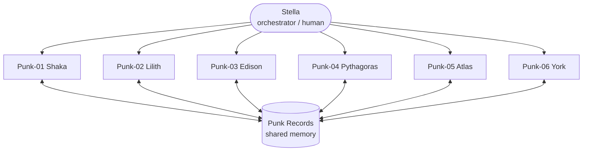

# vegapunk-agents

> A cognitive meta-framework: split hard reasoning across biased specialists that share one memory.

## What is this?

A single, general-purpose agent tends to be agreeable, shallow, and inconsistent: it brainstorms and judges in the same breath, so it does neither well. `vegapunk-agents` takes the opposite approach, inspired by Dr. Vegapunk from *One Piece*, whose mind is split into specialized satellites.

Each satellite has a **deliberate cognitive bias** (the optimist, the critic, the researcher, the brute-force worker...). Bias is a feature: it makes each role sharp and predictable. Quality emerges from the *friction* between them, coordinated through a shared memory (**Punk Records**) and supervised by a human (**Stella**).

The framework is use-case agnostic and implementation agnostic: one specification in `core/`, many runtimes in `flavors/`.

## Architecture overview

- **Stella** — the orchestrator, i.e. you. Sets goals, picks the activation mode, and approves critical actions (human-in-the-loop).
- **Punk Records** — the shared memory. Every satellite reads from and writes to this central knowledge/state store.
- **Satellites** — six specialized agents:

| ID | Name | Role | Cognitive bias |
|----|------|------|----------------|
| Punk-01 | Shaka | Logic & Architecture: validates coherence, rules, security; final approval | Rigor and consistency |
| Punk-02 | Lilith | Critique / Red Teaming: devil's advocate, finds flaws and biases | Skepticism |
| Punk-03 | Edison | Ideation & Strategy: unfiltered brainstorming, initial solution design | Divergent optimism |
| Punk-04 | Pythagoras | Research & Data: sources, metrics, structures findings into Punk Records | Evidence over opinion |
| Punk-05 | Atlas | Execution / Brute Force: high-volume work (mass code, assets, batches) | Throughput over elegance |
| Punk-06 | York | Operations & Maintenance: cleanup, formatting, logs, deliverable checks | Tidiness and completeness |

### Activation modes

| Mode | Satellites | Use when |
|------|-----------|----------|
| Light | 2 | Quick, low-stakes tasks |
| Standard | 4 | Most everyday work |
| Full Egghead | 6 | High-stakes or complex problems |



## Flavors

A flavor is an implementation of the `core/` spec on a specific runtime.

| Flavor | Folder | Status |
|--------|--------|--------|
| Claude Code (native) | `flavors/01-claude-code` | 🚧 Planned |
| LangGraph | `flavors/02-langgraph` | 🚧 Planned |
| CrewAI | `flavors/03-crewai` | 🚧 Planned |
| Anthropic SDK | `flavors/04-anthropic-sdk` | 🚧 Planned |

## Repo structure

```
vegapunk-agents/
├── README.md
├── CLAUDE.md
├── LICENSE
├── .gitignore
├── core/            # Spec + canonical prompts (single source of truth)
│   └── prompts/
├── flavors/         # Runtime-specific implementations of core/
│   ├── 01-claude-code/
│   ├── 02-langgraph/
│   ├── 03-crewai/
│   └── 04-anthropic-sdk/
├── visualizer/      # Egghead Monitor (use-case agnostic)
└── examples/        # Use cases built ON the framework
    └── startup-validator/
```

**Decoupling rule:** the framework (`core/`, `flavors/`, `visualizer/`) is 100% decoupled from use cases (`examples/`). Nothing in the framework may import, reference, or assume anything from `examples/`. Examples consume the framework, never the other way around.

## Roadmap

- [x] Phase 0 — Repo init
- [ ] Phase 1 — Core spec & prompts
- [ ] Phase 2 — Claude Code native flavor
- [ ] Phase 3 — LangGraph flavor + Startup Validator demo
- [ ] Phase 4 — Egghead Monitor visualizer
- [ ] Phase 5 — CrewAI & Anthropic SDK flavors

## Contributing

Contributions are welcome once the core spec lands (Phase 1). Until then, feel free to open issues with ideas or feedback. Please read `CLAUDE.md` for the project's ground rules, especially the decoupling rule.

## License

MIT — see [LICENSE](LICENSE).

## Disclaimer

This is a fan-inspired project. It is not affiliated with or endorsed by Eiichiro Oda, Shueisha, or Toei Animation. *One Piece* names are used for thematic reference only.
