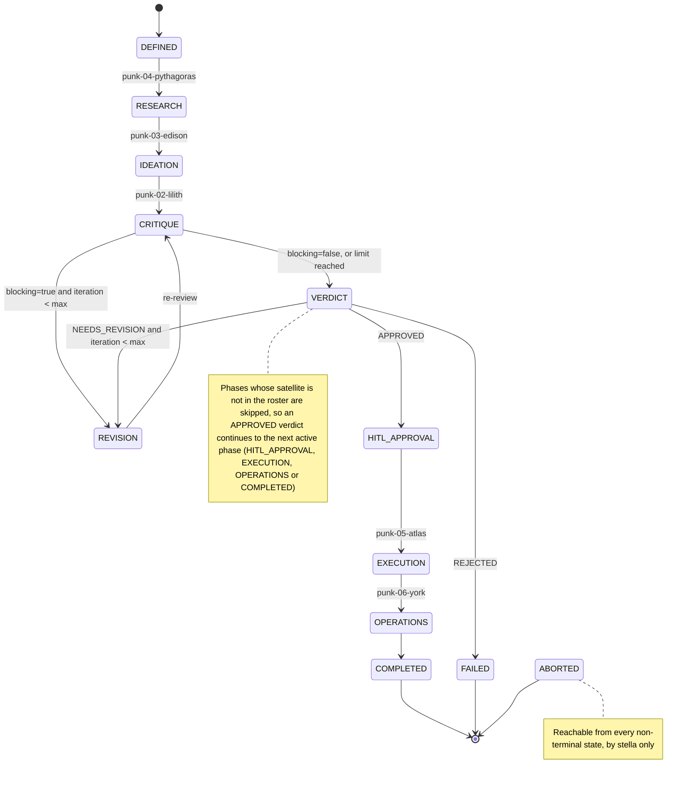

<!-- SPDX-License-Identifier: Apache-2.0 -->
<!-- Copyright 2026 Christian Gonzales Komiya -->

# vegapunk-agents — Architecture and Protocol

This document is the canonical protocol of `vegapunk-agents`. Flavors implement it; they never redefine it. Normative keywords (MUST, SHOULD, MAY) are used in the RFC 2119 sense. Data formats are defined in [`schemas/`](schemas/) and explained in [`punk-records.md`](punk-records.md).

## Definition

`vegapunk-agents` is a **Multi-Agent Architecture Pattern (and Conceptual Framework)**.

The pattern combines three ideas: a blackboard-style shared memory (`punk-records`) that is the only communication channel; a set of cognitively-biased specialists (the six satellites) that each contribute one kind of thinking; and a human orchestrator (`stella`) who sets the goal, chooses how many specialists to activate, and approves critical actions. Quality comes from the structured friction between specialists, not from any single agent being "smart".

## Components

- **`stella`** — the orchestrator, normally a human. Defines the mission, picks the activation mode and roster, approves critical actions, and may abort at any time.
- **`punk-records`** — the shared, append-only memory of one mission. All satellites read from it and write to it.
- **Satellites** — six specialists. "Reads" and "writes" are record types (see [Record types and write permissions](#record-types-and-write-permissions)).

| Canonical id | Name | Role | Cognitive bias | Reads | Writes |
|---|---|---|---|---|---|
| `punk-01-shaka` | Shaka | Logic & architecture: validates coherence, rules and security; issues the final verdict | Rigor and consistency | all | `verdict`, `note` |
| `punk-02-lilith` | Lilith | Critique / red teaming: devil's advocate, finds flaws and biases | Skepticism | `goal`, `finding`, `proposal`, `revision`, `note` | `critique`, `note` |
| `punk-03-edison` | Edison | Ideation & strategy: unfiltered brainstorming, initial solution design, revisions | Divergent optimism | `goal`, `finding`, `critique`, `verdict`, `note` | `proposal`, `revision`, `note` |
| `punk-04-pythagoras` | Pythagoras | Research & data: sources, metrics, structures findings | Evidence over opinion | `goal`, `critique`, `note` | `finding`, `note` |
| `punk-05-atlas` | Atlas | Execution / brute force: high-volume work (mass code, assets, batches) | Throughput over elegance | `goal`, `finding`, `proposal`, `revision`, `verdict`, `approval`, `note` | `artifact`, `note` |
| `punk-06-york` | York | Operations & maintenance: cleanup, formatting, logs, deliverable checks | Tidiness and completeness | all | `ops_log`, `note` |

`stella` reads all records and writes `goal`, `approval` and `note`.

## Communication rule (hard)

1. Satellites **never** message each other directly. Every exchange is a record in `punk-records`.
2. A satellite reads the records relevant to it and **appends** new ones. Nothing else is shared.
3. Records are **append-only**. A record is never edited or deleted. A correction is a new record whose `refs` points to the record it corrects.
4. Every record MUST name its author, type, phase and iteration, and MUST validate against [`schemas/punk-records.schema.json`](schemas/punk-records.schema.json).

### Record types and write permissions

| Record type | Meaning | Author (only) |
|---|---|---|
| `goal` | The mission goal and constraints | `stella` |
| `finding` | Sourced fact, metric or structured research result | `punk-04-pythagoras` |
| `proposal` | Initial solution or strategy | `punk-03-edison` |
| `critique` | Flaws, risks, biases found in a proposal or revision. MUST carry `blocking: true\|false` | `punk-02-lilith` |
| `revision` | Revised proposal addressing critiques or a verdict | `punk-03-edison` |
| `verdict` | Final judgement: `APPROVED`, `NEEDS_REVISION` or `REJECTED` | `punk-01-shaka` |
| `approval` | Human approval of a critical action | `stella` |
| `artifact` | Produced deliverable or batch output | `punk-05-atlas` |
| `ops_log` | Cleanup, formatting, log or deliverable-check report | `punk-06-york` |
| `note` | Free-form remark that fits no other type | any author |

The schema enforces this table: a record whose author may not write its type is invalid.

## Activation modes

Each mode has a default roster. `stella` MAY override the roster, but every roster MUST include `punk-01-shaka`, because only Shaka issues verdicts. The mode is recorded in `mission.mode`, the actual roster in `mission.roster`.

| Mode | Satellites | Default roster |
|---|---|---|
| Light (`light`) | 2 | `punk-03-edison`, `punk-01-shaka` |
| Standard (`standard`) | 4 | `punk-04-pythagoras`, `punk-03-edison`, `punk-02-lilith`, `punk-01-shaka` |
| Full Egghead (`full`) | 6 | `punk-01-shaka`, `punk-02-lilith`, `punk-03-edison`, `punk-04-pythagoras`, `punk-05-atlas`, `punk-06-york` |

When `stella` should pick each mode:

- **Light** — quick, low-stakes, reversible work where an idea plus a sanity check is enough. No research, no adversarial review.
- **Standard** — the everyday default. The question needs facts, and the answer needs to survive an adversarial review, but nothing has to be mass-produced.
- **Full Egghead** — high-stakes, complex or irreversible work, or work that produces a large deliverable that must be built and then checked.

## Mission lifecycle

A mission moves through the states below. The current state is `state.phase` in `punk-records`.

| Phase | Active satellite | Produces | Leaves the phase when |
|---|---|---|---|
| `DEFINED` | `stella` | `goal` | the goal is recorded and the roster is chosen |
| `RESEARCH` | `punk-04-pythagoras` | `finding` | findings are written |
| `IDEATION` | `punk-03-edison` | `proposal` | a proposal is written |
| `CRITIQUE` | `punk-02-lilith` | `critique` | a critique is written |
| `REVISION` | `punk-03-edison` | `revision` | a revision is written |
| `VERDICT` | `punk-01-shaka` | `verdict` | a verdict is written |
| `HITL_APPROVAL` | `stella` | `approval` | Stella approves (or aborts) |
| `EXECUTION` | `punk-05-atlas` | `artifact` | artifacts are written |
| `OPERATIONS` | `punk-06-york` | `ops_log` | the ops log is written |
| `COMPLETED` / `FAILED` / `ABORTED` | — | — | terminal |

### Rules

- **Skipping.** A phase whose satellite is not in the roster is skipped; the mission moves to the next active phase in the order above. `DEFINED`, `VERDICT` and the terminal states are never skipped.
- **Iteration counter.** `state.iteration` starts at 0 and is incremented each time the mission enters `REVISION`. Records carry the iteration in which they were written.
- **Loop limit.** `mission.max_iterations` (default 2) caps the number of `REVISION` entries. A value of 0 forbids revisions.
- **Critique → revision.** The mission goes `CRITIQUE` → `REVISION` if the latest `critique` of the current iteration has `blocking: true` AND `state.iteration < mission.max_iterations`; the revision is then followed by a new `CRITIQUE`. Otherwise it goes `CRITIQUE` → `VERDICT`. Flavors MUST NOT infer blocking from the critique text; only the `blocking` field counts. If `punk-02-lilith` is not in the roster, `CRITIQUE` is skipped.
- **Verdict.** Shaka's verdict is one of `APPROVED`, `NEEDS_REVISION`, `REJECTED`.
  - `NEEDS_REVISION` returns to `REVISION` and counts toward the loop limit. It is only valid while `iteration < max_iterations`; once the limit is reached, Shaka MUST choose `APPROVED` or `REJECTED`.
  - `REJECTED` moves the mission to `FAILED` unless `stella` restarts it. A restart is a new mission that may reference the old records.
  - `APPROVED` moves the mission to `HITL_APPROVAL`, or directly to the next active phase if no checkpoint is required (see below).
- **No active execution.** If `punk-05-atlas` is not in the roster, the approved `proposal`/`revision` is the deliverable and the mission continues to `OPERATIONS` (if active) or `COMPLETED`.
- **Failure.** A satellite or flavor that cannot continue (unrecoverable error) moves the mission to `FAILED` and emits `mission_failed` with a reason.

## Human-in-the-loop checkpoints

- **Mandatory before `EXECUTION`.** If `punk-05-atlas` is in the roster, the mission MUST pass `HITL_APPROVAL`: execution never starts without a `stella` `approval` record.
- **Optional after `VERDICT`.** In every other case `stella` MAY require `HITL_APPROVAL`; Light mode typically uses it as the only human gate. When not required, the phase is skipped.
- **Declining.** At `HITL_APPROVAL`, `stella` either approves (writes an `approval` record) or aborts the mission. To change course instead, `stella` aborts and starts a new mission.
- **Abort at any time.** `stella` can move the mission to `ABORTED` from any non-terminal state.
- A flavor MUST emit `hitl_requested` when it enters the checkpoint and `hitl_resolved` when `stella` answers.

## Flavor compliance checklist

Every flavor MUST implement:

- [ ] The three activation modes with the default rosters above, and Stella's roster override (always including `punk-01-shaka`).
- [ ] The full lifecycle, including phase skipping, the iteration counter and the loop limit (`max_iterations`, default 2).
- [ ] Shaka's verdict rules, including the forced `APPROVED`/`REJECTED` choice once the loop limit is reached.
- [ ] `punk-records` as the only communication channel: no direct satellite-to-satellite messages.
- [ ] Append-only records that validate against `schemas/punk-records.schema.json`, including the author → record-type permissions.
- [ ] Event emission conforming to `schemas/event.schema.json`, as one JSON object per line (`events.jsonl`). At minimum: `mission_started`, `phase_changed`, `record_written`, `hitl_requested`, `hitl_resolved` and exactly one terminal event (`mission_completed`, `mission_failed` or `mission_aborted`). `satellite_activated` and `satellite_idle` SHOULD be emitted.
- [ ] The human-in-the-loop gate before `EXECUTION`, and the ability for `stella` to abort at any state.
- [ ] Canonical ids everywhere: `stella`, `punk-records`, `punk-01-shaka` … `punk-06-york`.
- [ ] No dependency on, or knowledge of, any use case.
