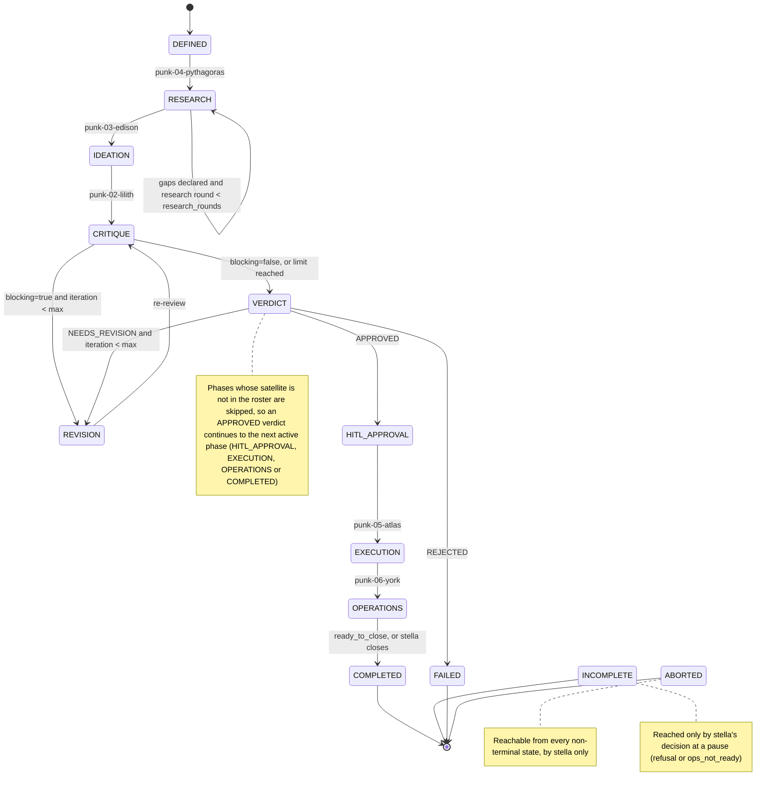

<!-- SPDX-License-Identifier: Apache-2.0 -->
<!-- Copyright 2026 Christian Gonzales Komiya -->

# vegapunk-agents — Architecture and Protocol

This document is the canonical protocol of `vegapunk-agents`. Flavors implement it; they never redefine it. Normative keywords (MUST, SHOULD, MAY) are used in the RFC 2119 sense. Data formats are defined in [`schemas/`](schemas/) and explained in [`punk-records.md`](punk-records.md).

Specification version: 0.3.1

## Definition

`vegapunk-agents` is a **Multi-Agent Architecture Pattern (and Conceptual Framework)**.

The pattern combines three ideas: a blackboard-style shared memory (`punk-records`) that is the only communication channel; a set of cognitively-biased specialists (the six satellites) that each contribute one kind of thinking; and a human orchestrator (`stella`) who sets the goal, chooses how many specialists to activate, and approves critical actions. Quality comes from the structured friction between specialists, not from any single agent being "smart".

## Components

- **`stella`** — the orchestrator, normally a human. Defines the mission, picks the activation mode and roster, approves critical actions, and may abort at any time.
- **`punk-records`** — the shared, append-only memory of one mission. All satellites read from it and write to it.
- **Satellites** — six specialists. "Reads" and "writes" are record types (see [Record types and write permissions](#record-types-and-write-permissions)).

| Canonical id | Name | Role | Cognitive bias | Reads | Writes |
|---|---|---|---|---|---|
| `punk-01-shaka` | Shaka | Logic & architecture: validates coherence, rules and security; issues the final verdict | Rigor and consistency | all | `verdict`, `flag`, `refusal`, `note` |
| `punk-02-lilith` | Lilith | Critique / red teaming: devil's advocate, finds flaws and biases | Skepticism | `goal`, `finding`, `proposal`, `critique`, `revision`, `flag`, `note` | `critique`, `flag`, `refusal`, `note` |
| `punk-03-edison` | Edison | Ideation & strategy: unfiltered brainstorming, initial solution design, revisions | Divergent optimism | `goal`, `finding`, `proposal`, `critique`, `revision`, `verdict`, `flag`, `note` | `proposal`, `revision`, `flag`, `refusal`, `note` |
| `punk-04-pythagoras` | Pythagoras | Research & data: sources, metrics, structures findings | Evidence over opinion | `goal`, `finding`, `critique`, `flag`, `note` | `finding`, `flag`, `refusal`, `note` |
| `punk-05-atlas` | Atlas | Execution / brute force: high-volume work (mass code, assets, batches) | Throughput over elegance | `goal`, `finding`, `proposal`, `revision`, `verdict`, `approval`, `flag`, `note` | `artifact`, `flag`, `refusal`, `note` |
| `punk-06-york` | York | Operations & maintenance: cleanup, formatting, logs, deliverable checks | Tidiness and completeness | all | `ops_log`, `flag`, `refusal`, `note` |

`stella` reads all records and writes `goal`, `approval`, `flag` and `note`.

## Communication rule (hard)

1. Satellites **never** message each other directly. Every exchange is a record in `punk-records`.
2. A satellite reads the records relevant to it and **appends** new ones. Nothing else is shared.
3. Records are **append-only**. A record is never edited or deleted. A correction is a new record whose `refs` points to the record it corrects.
4. Every record MUST name its author, type, phase and iteration, and MUST validate against [`schemas/punk-records.schema.json`](schemas/punk-records.schema.json).

### Selective reading

- A satellite MUST NOT receive records whose type is not in its "Reads" column.
- Flavors MAY pass a satellite only a subset of the records it may read, to save context. If they do, the subset MUST include at least:
  1. the `goal` record;
  2. every `finding` the satellite may read;
  3. every record the satellite may read from the current iteration and the previous one;
  4. every record referenced in the `refs` of any record passed (one level) that the satellite may read;
  5. for `punk-01-shaka`: every `critique` with `blocking: true` in the mission, so the verdict can check that all of them are resolved or overruled;
  6. every `flag` in the mission and, for each flag already resolved, the `verdict` that resolved it (only for satellites whose "Reads" column includes `verdict`).
- Passed records MUST be complete and unaltered, in their original order. Selecting is allowed; summarizing or rewriting records is not.
- Records not passed remain in `punk-records` unchanged (append-only).
- If a satellite needs context it did not receive, it writes a `note` asking for it; the flavor SHOULD pass the requested records in the satellite's next activation.
- A record MAY reference (`refs`) records of types the reading satellite cannot read (for example, Atlas reads the `verdict`, which cites a `critique`). Such references are NOT dangling: the satellite MUST NOT report them as broken or nonexistent, and MAY note that it cannot read them.

### Record types and write permissions

| Record type | Meaning | Author (only) |
|---|---|---|
| `goal` | The mission goal and constraints | `stella` |
| `finding` | Sourced fact, metric or structured research result | `punk-04-pythagoras` |
| `proposal` | Initial solution or strategy | `punk-03-edison` |
| `critique` | Flaws, risks, biases found in a proposal or revision. MUST carry `blocking: true\|false` | `punk-02-lilith` |
| `revision` | Revised proposal addressing critiques or a verdict | `punk-03-edison` |
| `verdict` | Final judgement: `APPROVED`, `NEEDS_REVISION` or `REJECTED` | `punk-01-shaka` |
| `approval` | Human approval of a critical action | `stella` |
| `artifact` | Produced deliverable or batch output | `punk-05-atlas` |
| `ops_log` | Cleanup, formatting, log or deliverable-check report | `punk-06-york` |
| `flag` | Marks earlier records as suspect; Shaka resolves every flag before a verdict. MUST reference at least one record | any author |
| `refusal` | A satellite declines the task it was given and says why (`reason`) | any satellite |
| `note` | Free-form remark that fits no other type | any author |

The schema enforces this table: a record whose author may not write its type is invalid.

## Activation modes

Each mode has a default roster. `stella` MAY override the roster, but every roster MUST include `punk-01-shaka`, because only Shaka issues verdicts. The mode is recorded in `mission.mode`, the actual roster in `mission.roster`.

| Mode | Satellites | Default roster |
|---|---|---|
| Light (`light`) | 2 | `punk-03-edison`, `punk-01-shaka` |
| Standard (`standard`) | 4 | `punk-04-pythagoras`, `punk-03-edison`, `punk-02-lilith`, `punk-01-shaka` |
| Full Egghead (`full`) | 6 | `punk-01-shaka`, `punk-02-lilith`, `punk-03-edison`, `punk-04-pythagoras`, `punk-05-atlas`, `punk-06-york` |

When `stella` should pick each mode:

- **Light** — quick, low-stakes, reversible work where an idea plus a sanity check is enough. No research, no adversarial review.
- **Standard** — the question needs facts, and the answer needs to survive an adversarial review, but nothing has to be mass-produced.
- **Full Egghead** — high-stakes, complex or irreversible work, or work that produces a large deliverable that must be built and then checked.

## Mission lifecycle

A mission moves through the states below. The current state is `state.phase` in `punk-records`.

| Phase | Active satellite | Produces | Leaves the phase when |
|---|---|---|---|
| `DEFINED` | `stella` | `goal` | the goal is recorded and the roster is chosen |
| `RESEARCH` | `punk-04-pythagoras` | `finding` | findings are written (the phase repeats while gaps remain and `research_rounds` allows) |
| `IDEATION` | `punk-03-edison` | `proposal` | a proposal is written |
| `CRITIQUE` | `punk-02-lilith` | `critique` | a critique is written |
| `REVISION` | `punk-03-edison` | `revision` | a revision is written |
| `VERDICT` | `punk-01-shaka` | `verdict` | a verdict is written |
| `HITL_APPROVAL` | `stella` | `approval` | Stella approves (or aborts) |
| `EXECUTION` | `punk-05-atlas` | `artifact` | artifacts are written |
| `OPERATIONS` | `punk-06-york` | `ops_log` | the ops log says `ready_to_close: true`, or `stella` decides at the pause |
| `COMPLETED` / `INCOMPLETE` / `FAILED` / `ABORTED` | — | — | terminal |

### Rules

- **Skipping.** A phase whose satellite is not in the roster is skipped; the mission moves to the next active phase in the order above. `DEFINED`, `VERDICT` and the terminal states are never skipped.
- **Research rounds.** `mission.research_rounds` (default 1) caps the number of entries into `RESEARCH`; `state.research_round` counts them (0 until the first).
  - After a round, the mission goes `RESEARCH` → `RESEARCH` if at least one `finding` of that round carries `gaps` AND `state.research_round < mission.research_rounds`; otherwise it continues to the next active phase.
  - Every `phase_changed` into `RESEARCH` MUST carry `research_round`.
  - Each activation of `punk-04-pythagoras` reads the earlier findings and their `gaps`, and SHOULD investigate the gaps instead of repeating work.
  - Research rounds do NOT count toward `max_iterations`. Flavors MAY apply their own limits (for example on searches) to each round.
  - If `punk-04-pythagoras` is not in the roster, `RESEARCH` is skipped and `state.research_round` stays 0.
- **Iteration counter.** `state.iteration` starts at 0 and is incremented each time the mission enters `REVISION`. Records carry the iteration in which they were written.
- **Loop limit.** `mission.max_iterations` (default 2) caps the number of `REVISION` entries. A value of 0 forbids revisions.
- **Critique → revision.** The mission goes `CRITIQUE` → `REVISION` if the latest `critique` of the current iteration has `blocking: true` AND `state.iteration < mission.max_iterations`; the revision is then followed by a new `CRITIQUE`. Otherwise it goes `CRITIQUE` → `VERDICT`. Flavors MUST NOT infer blocking from the critique text; only the `blocking` field counts. If `punk-02-lilith` is not in the roster, `CRITIQUE` is skipped. If a `critique` with `blocking: true` is written and the roster does not include `punk-03-edison` (so no `REVISION` is possible), `REVISION` is skipped and the mission goes to `VERDICT`; in that case Shaka MUST expressly address the blocking critique in the verdict, either by approving with a justification for overruling it, or by rejecting.
- **Verdict.** Shaka's verdict is one of `APPROVED`, `NEEDS_REVISION`, `REJECTED`.
  - `NEEDS_REVISION` returns to `REVISION` and counts toward the loop limit. It is only valid while `iteration < max_iterations`; once the limit is reached, Shaka MUST choose `APPROVED` or `REJECTED`.
  - Shaka MAY overrule a critique with `blocking: true` if it is not supported by the mission goal, constraints or findings. An overruled critique counts as resolved for the verdict. Overruling MUST be justified explicitly in the verdict content, referencing the goal, constraint or finding it relies on. Overruling never changes the critique record (append-only).
  - Shaka MUST NOT approve a plan that leaves a deliverable named in the done-criteria unplanned. An `APPROVED` verdict lists the non-blocking improvements to apply under "Apply at execution"; they form part of the approved plan.
  - `REJECTED` moves the mission to `FAILED` unless `stella` restarts it. A restart is a new mission that may reference the old records.
  - `APPROVED` moves the mission to `HITL_APPROVAL`, or directly to the next active phase if no checkpoint is required (see below).
- **No active execution.** If `punk-05-atlas` is not in the roster, the approved `proposal`/`revision` is the deliverable and the mission continues to `OPERATIONS` (if active) or `COMPLETED`.
- **Refusals.** A satellite that cannot do what its phase asks writes a `refusal` instead of the expected record. It MUST NOT write an empty or placeholder record (for example an `artifact` saying that nothing was produced).
  - A `refusal` does not complete the phase. The flavor MUST stop, emit `hitl_requested` with `kind: "refusal"` and wait for `stella`, who chooses `reactivate`, `incomplete` or `aborted`.
  - `reactivate` runs the same satellite again and is valid only if `stella` supplies, with the decision, a `note` saying what was missing or how to proceed. A reactivated satellite does not receive `refusal` records in its context unless its "Reads" column includes them (`punk-01-shaka` and `punk-06-york` do read them), and a refusal adds nothing it lacked, so without the note it would face the same situation and refuse again. Flavors MUST NOT accept `reactivate` without that note.
  - Each satellite may be reactivated once per entry into a phase (every pass of `CRITIQUE` or `REVISION` and every research round is a new entry). If it refuses again within the same entry, only `incomplete` and `aborted` are valid.
  - The flavor and any AI coordinator MUST NOT retry a refused task on their own or reassign it to another satellite.
  - A draft that fails validation is NOT a refusal; the flavor's retry policy handles it.
- **Flags.** Any author MAY write a `flag` in any phase, alongside the record the phase expects (as with a `note`). Its `refs` point to the suspect records and its content says why.
  - Before writing a `verdict`, Shaka MUST resolve, in `flag_resolutions`, every earlier `flag` that no previous verdict has resolved, as `upheld` or `dismissed`. Flavors MUST reject a verdict that leaves one unresolved or that names a record that is not a `flag`.
  - `dismissed`: the verdict content justifies it.
  - `upheld`: the flagged records MUST NOT be used as a basis of the plan, and the verdict MUST say what changes. The verdict may be `APPROVED` only if the plan no longer depends on them.
  - A `flag` written after the last verdict (for example by York) does not reopen the loop; the flavor includes it in the final report to `stella`.
  - Flagged records are not removed (append-only).
- **Operations check.** Every `ops_log` states `ready_to_close`.
  - `true`: the mission moves to `COMPLETED`.
  - `false`: the flavor MUST stop, emit `hitl_requested` with `kind: "ops_not_ready"` and wait for `stella`, who chooses `close` (`COMPLETED`; the `ops_log` stays on record), `incomplete` or `aborted`. An AI coordinator never closes the mission on its own.
- **Incomplete.** `INCOMPLETE` is terminal (`state.status: "incomplete"`) and is reached only by `stella`'s decision at a refusal or `ops_not_ready` pause; the flavor emits `mission_incomplete` with a `reason`.
  - It means that work was done but the goal was not fully met. It is distinct from `FAILED` (a `REJECTED` verdict or an unrecoverable error) and from `ABORTED`.
  - An `INCOMPLETE` mission keeps all its records.
- **Failure.** A satellite or flavor that cannot continue (unrecoverable error) moves the mission to `FAILED` and emits `mission_failed` with a reason. A refusal is not a failure.

## Human-in-the-loop checkpoints

- **Mandatory before `EXECUTION`.** If `punk-05-atlas` is in the roster, the mission MUST pass `HITL_APPROVAL`: execution never starts without a `stella` `approval` record.
- **Optional after `VERDICT`.** In every other case `stella` MAY require `HITL_APPROVAL`; Light mode typically uses it as the only human gate. When not required, the phase is skipped.
- **Declining.** At `HITL_APPROVAL`, `stella` either approves (writes an `approval` record) or aborts the mission. To change course instead, `stella` aborts and starts a new mission.
- **Sources before approval.** Before asking `stella` to approve, the flavor's engine MUST show the external sources that support the decision (those listed in the mission's `finding` records), and MUST state how many findings are `unsourced`.
- **Abort at any time.** `stella` can move the mission to `ABORTED` from any non-terminal state.

### Checkpoint kinds

| `kind` | Raised when | Valid decisions |
|---|---|---|
| `approval` | the mission enters `HITL_APPROVAL` | `approved`, `aborted` |
| `refusal` | a satellite writes a `refusal` | `reactivate` (with a `note`), `incomplete`, `aborted` |
| `ops_not_ready` | an `ops_log` has `ready_to_close: false` | `close`, `incomplete`, `aborted` |

- A flavor MUST emit `hitl_requested`, with its `kind`, when it pauses, and `hitl_resolved` when `stella` answers. It MUST NOT accept a decision that is not valid for that `kind`.
- A `refusal` or `ops_not_ready` pause is not a lifecycle state: `state.phase` stays in the phase that raised it until `stella` decides.
- `hitl_resolved` MUST be emitted before the `record_written` event of any `note` or `approval` that `stella` writes as part of the decision.
- After `reactivate`, the flavor emits `satellite_activated` again (if it emits that event).

## Flavor compliance checklist

Every flavor MUST implement:

- [ ] The three activation modes with the default rosters above, and Stella's roster override (always including `punk-01-shaka`).
- [ ] The full lifecycle, including phase skipping, the iteration counter, the loop limit (`max_iterations`, default 2) and the `INCOMPLETE` state.
- [ ] Research rounds: `research_rounds` (default 1), `state.research_round`, and re-entry into `RESEARCH` only when gaps are declared and the limit allows it.
- [ ] Shaka's verdict rules, including the forced `APPROVED`/`REJECTED` choice once the loop limit is reached.
- [ ] Refusals: the pause for `stella`, `reactivate` only with her `note`, the limit of one reactivation per phase entry, and no automatic retry or reassignment.
- [ ] Flags: the verdict gate on `flag_resolutions`, and later flags in the final report.
- [ ] The `ready_to_close` check of every `ops_log`, with its `ops_not_ready` pause.
- [ ] `punk-records` as the only communication channel: no direct satellite-to-satellite messages.
- [ ] Append-only records that validate against `schemas/punk-records.schema.json`, including the author → record-type permissions.
- [ ] Event emission conforming to `schemas/event.schema.json`, as one JSON object per line (`events.jsonl`). At minimum: `mission_started`, `phase_changed` (with `research_round` into `RESEARCH`), `record_written`, `hitl_requested` (with `kind`), `hitl_resolved` and exactly one terminal event (`mission_completed`, `mission_incomplete`, `mission_failed` or `mission_aborted`). `satellite_activated` and `satellite_idle` SHOULD be emitted, and only for satellites, never for `stella`.
- [ ] The human-in-the-loop gate before `EXECUTION`, and the ability for `stella` to abort at any state.
- [ ] Canonical ids everywhere: `stella`, `punk-records`, `punk-01-shaka` … `punk-06-york`.
- [ ] No dependency on, or knowledge of, any use case.
