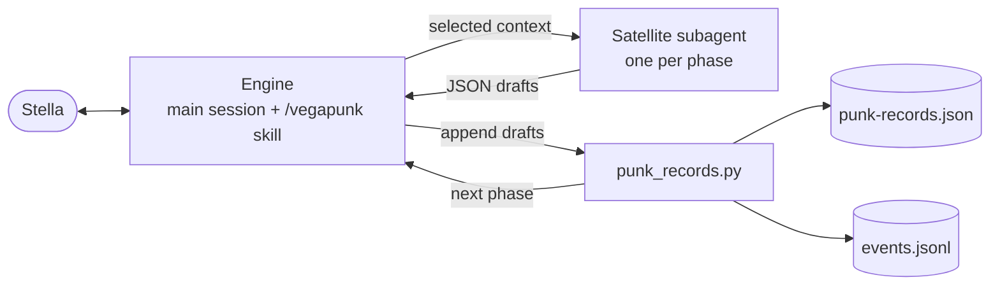

<!--
SPDX-License-Identifier: Apache-2.0
Copyright 2026 Christian Gonzales Komiya
-->

# Flavor 01 — Claude Code (native)

Implements the `core/` spec of vegapunk-agents (a **Multi-Agent Architecture Pattern (and Conceptual Framework)**) with Claude Code native features: six generated subagents (`punk-01-shaka` … `punk-06-york`), an engine skill (`/vegapunk`) run by the main session, and a deterministic Python script (`punk_records.py`) that owns Punk Records and the mission lifecycle.

- **Status:** ✅ Working (v0.1, Phase 2): tested in light and standard modes; full mode (Atlas and York) not yet tested.
- The pattern is model-agnostic. Only this flavor and `04-anthropic-sdk` are tied to Claude.

## How it works



1. Stella talks to the engine, which is the main Claude Code session running the `/vegapunk` skill.
2. For each phase the engine launches one subagent and passes it only its selected context (core "Selective reading").
3. The engine saves the satellite's JSON drafts. `punk_records.py` validates them against the core schema, appends them to `punk-records.json`, emits `events.jsonl` and computes the next phase.
4. Satellites never talk to each other and cannot spawn subagents (`disallowedTools: Agent`).

## Requirements

| Item | Detail |
|---|---|
| Claude Code | Recommended v2.1.271+ (`omitClaudeMd`). Older versions work, but each satellite loads the project `CLAUDE.md`, which costs more tokens. |
| Python | 3.10+ |
| Runtime dependency | `jsonschema` — `pip install "jsonschema>=4,<5"` |
| Access | A Claude subscription (Pro/Max) or an API key. Nothing in the flavor assumes either. |

## Install

1. Copy `flavors/01-claude-code/.claude/` into the root of your project, merging it with an existing `.claude/` folder if you have one (do not overwrite your own settings). It holds `agents/`, `skills/vegapunk/` and `vegapunk/` (the script, schemas and `roles.json`).
2. Add `.vegapunk/` to your `.gitignore` (mission folders).
3. Tip: user-level hooks, plugins and MCP servers load into every session and add context to every engine call. Disable what you do not need when measuring, e.g. a project `.claude/settings.local.json` with `{"disableAllHooks": true}`.
4. Permissions: the skill's `allowed-tools` only covers the first turn, so expect permission prompts for `python .claude/vegapunk/punk_records.py` and for writes under `.vegapunk/`. Allowing them for the session is enough.

## Usage

```
/vegapunk <goal>
```

The engine helps Stella write the outcome, constraints and done-criteria, then suggests a mode:

| Mode | Satellites | Notes |
|---|---|---|
| light | Edison + Shaka | Quick, low-stakes, reversible work. |
| standard | + Pythagoras + Lilith | Everyday work that needs facts and an adversarial review. |
| full | + Atlas + York | Builds and checks a deliverable. Approval is mandatory before execution. |

It waits for an explicit confirmation before `init`. Then:

- **Loop:** the engine asks `punk_records.py` for the next actor, invokes that satellite, saves its drafts and repeats until the mission ends.
- **HITL:** Stella approves or aborts. The verdict and the deliverable are shown verbatim.
- **Stella's notes:** on request, the engine records a note mid-mission verbatim. The next satellite reads it.
- **Timeline:** `python .claude/vegapunk/punk_records.py timeline --mission-dir <dir>` prints the mission history as chronological Markdown, one bullet per record (read-only, no LLM, writes nothing).
- **Abort:** possible at any time.
- **Changes:** a change request is a new mission that references the old one.

Files in `.vegapunk/missions/<id>/`:

| File | Content |
|---|---|
| `punk-records.json` | The shared memory (validated against the core schema) |
| `events.jsonl` | Append-only event log |
| `engine.json` | Flavor-only settings |
| `drafts/` | Satellite JSON drafts as saved by the engine |
| `notes/` | Stella's notes |
| `deliverable.md` | The final deliverable |
| `measurement/` | Output of `measure_mission.py` |

## Configuration

`agents.config.yaml` holds, per satellite, `model`, `color`, `tools` and `maxTurns`; and for the engine, `effort`. After editing, regenerate and copy `.claude/` again:

```
python flavors/01-claude-code/tools/generate_agents.py
```

Default models: `sonnet` for Edison, Pythagoras, Lilith and Shaka; `haiku` for Atlas and York.

## Usage and cost

### Subscription vs API

- **Subscription:** missions count toward the plan's usage limits (`/usage` shows the share per skill).
- **API:** you pay per token. Set a workspace spend limit in the Console.

Tokens are reported first; dollars are the API-equivalent cost.

### Measured runs

Run on 2026-11-20 with Sonnet 5.5 for engine and satellites, the same goal in all three runs, and human approval after the verdict. Cost uses API list prices with the exact 5m/1h cache split from the logs.

| Run | Mode | Satellite calls | Engine calls | Tokens | API cost | Engine share (tokens / cost) |
|---|---|---|---|---|---|---|
| P1 | light | 2 | 16 | 995,753 | $0.376 | 98% / 86% |
| P2 | standard (1 revision) | 7 | 34 | 3,098,194 | $1.284 | 97% / 83% |
| P3 | light, optimized engine | 2 | 15 | 951,921 | $0.368 | 98% / 83% |

One run per configuration and a single goal, so treat these as orders of magnitude. P1 ran with failing user-level hooks enabled; P2 and P3 ran with hooks disabled, so part of the P1 → P3 difference may come from that and not from the engine changes.

- Each satellite call costs about 9–15k tokens.
- The engine re-reads its whole context (~40–60k tokens: Claude Code system prompt and tools, skills, the conversation) on every tool call, so it dominates the total.
- Defining the mission with Stella (SETUP) is a near-fixed ~$0.11–0.12.
- Standard costs ~3.4× light and bought visibly better output: a blocking critique caught an unfinished rule.

Call this the **LLM-orchestrator tax**: the price of using Claude Code as the engine (zero engine code, natural conversation, built-in permissions and web search). Flavors whose engine is code (`02-langgraph`, `04-anthropic-sdk`) should pay mainly for the satellites.

Prices change. They are kept, with their date, in `tools/pricing.yaml`.

## Measure your own missions

```
python flavors/01-claude-code/tools/measure_mission.py measure --mission-dir <dir> --label <name>
python flavors/01-claude-code/tools/measure_mission.py compare <summary.csv> <summary.csv> ...
```

| Output | Content |
|---|---|
| `calls.csv` | One row per call, with phase and actor |
| `summary.csv` / `summary.json` | Totals per mission |
| `compare.csv` | Side-by-side table from `compare` |

It reads Claude Code session logs in `~/.claude/projects` and the mission's `events.jsonl`. Dev tool: needs `pyyaml`.

## Models

| Support | Providers |
|---|---|
| Supported | Claude via subscription, Anthropic API, Amazon Bedrock, Google Vertex AI, Microsoft Foundry |
| Experimental, no guarantee | Anthropic-compatible endpoints (e.g. DeepSeek at `https://api.deepseek.com/anthropic`, OpenRouter); OpenAI models only through a gateway (OpenRouter, LiteLLM) |

A model that breaks the draft contract fails visibly: `punk_records.py` rejects the draft and Punk Records stays intact.

## Known limitations (v0.1)

- Stella can only approve or abort at the checkpoint (no "approve with changes").
- The engine's mode suggestion can vary between runs.
- On some Claude Code versions subagents show as "Backgrounded agent" even though the skill asks for the foreground (the engine still waits for each one).
- The engine rewrites each draft to save it, so its output is paid twice.

## Development

- The generator builds the subagents, `roles.json`, the schema copies and `SKILL.md` from `core/` and `templates/`. `--check` fails if anything drifts (CI: `validate-flavor-01.yml`, also triggered by changes in `core/`). Never edit generated files by hand.
- Tests: `python -m unittest discover -s flavors/01-claude-code/tests`
- Development dependencies are listed in `requirements.txt`.
